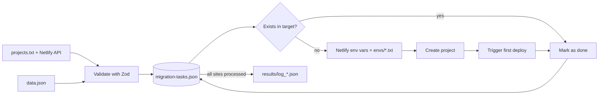

# netlify-to-cloudflare-migrator

[](https://github.com/JeremyAyza/netlify-to-cloudflare-migrator/actions/workflows/ci.yml) [](LICENSE)

CLI that recreates Netlify sites on Cloudflare Pages (or Render) through their APIs: same GitHub repo and branch, build settings and environment variables, plus the first deploy.

> Status: built in May 2026 for a one-time migration at work, where it moved about 20 production sites. Tests, CI, Netlify pagination and the `cf` helper script were added in October 2026, after that migration.

## Why I built it

Netlify charged USD 19 per Git collaborator per month. With 5 developers on the team it stopped being worth it, and the team decided to move to Cloudflare Pages' free plan. Doing it by hand meant copying build settings and environment variables for about 20 sites, one at a time, which was slow and easy to get wrong. Automating it was my idea.

Result: about 20 sites migrated (internal web apps and landing pages), plus a few landing pages moved to Render with the same tool. The team now runs 25 projects on Cloudflare's free plan, saving USD 95/month at the time (USD 133/month with today's 7 developers). The Netlify sites were kept with builds turned off, as a fallback.

## What it does

- Reads site settings from the Netlify API (filtered by `projects.txt`) or from a JSON export, and validates them with Zod before creating anything.
- Copies production and preview environment variables from Netlify; files in `envs/<site>.txt` add or override values.
- Creates the Cloudflare Pages project linked to the same repo and branch, then triggers the first deployment, because Cloudflare does not start one when a project is created through the API. With `TARGET_PROVIDER=render` it creates a Render static site instead.
- Saves progress after every site, so an interrupted run resumes where it stopped and sites that already exist in the target are skipped.
- `disable-builds` turns off automatic builds on the Netlify sites, so they stay available without building twice.
- `cf` lists Cloudflare Pages projects, shows one project's settings and adds or updates its environment variables.

## How to run it

Requirements:

- Node.js 20+ (see `.nvmrc`)
- A Cloudflare API token with Pages edit access, and the Cloudflare Pages GitHub app installed on the repositories' owner
- A Netlify personal access token (for API mode and `disable-builds`)
- For Render: a Render API key

```bash
git clone https://github.com/JeremyAyza/netlify-to-cloudflare-migrator
cd netlify-to-cloudflare-migrator
npm install
cp .env.example .env   # fill in your tokens
```

| Variable | When | Used for |
|---|---|---|
| `CLOUDFLARE_ACCOUNT_ID`, `CLOUDFLARE_API_TOKEN` | Cloudflare target and `cf` | Creating, reading and updating Pages projects |
| `NETLIFY_API_TOKEN` | API mode and `disable-builds` | Reading sites and env vars, stopping builds |
| `TARGET_PROVIDER` | Optional, default `cloudflare` | `cloudflare` or `render` |
| `RENDER_API_TOKEN`, `RENDER_OWNER_ID` | Render target | Creating Render static sites (`RENDER_OWNER_ID` is detected if empty) |

**From the Netlify API**

```bash
cp projects.example.txt projects.txt   # one Netlify site name per line, # for comments
npm run migrate
```

**From a JSON export**: without `NETLIFY_API_TOKEN` or without `projects.txt`, the script reads `data.json` instead. It must be an array of Netlify site objects; see `data.example.json`.

<details>
<summary>Override env vars, turn off Netlify builds and manage Cloudflare projects</summary>

```text
# envs/my-landing.txt (KEY=VALUE, local values win over Netlify's)
NODE_VERSION=22
VITE_API_URL=https://api.example.com
```

```bash
npm run disable-builds                                  # stop builds for every site in projects.txt
npm run cf -- list                                      # all Pages projects and their last deploy
npm run cf -- get my-landing                            # build settings and env var names
npm run cf -- set-env my-landing API_URL=https://x.dev  # production only
npm run cf -- set-env my-landing API_URL=https://x.dev --all   # production and preview
```

Each migration run writes a log to `results/`; `disable-builds` writes to `results_disable_builds/`.
</details>

## How it works



```text
src/
├── index.ts               # Picks the target provider from TARGET_PROVIDER
├── migrator.ts            # Main loop: load or resume tasks, migrate site by site
├── netlify.ts             # Netlify API: list sites, read env vars, stop builds
├── schema.ts, adapter.ts  # Validate Netlify data and reduce it to the fields we need
├── taskManager.ts         # Save, resume and archive progress
├── providers/             # Cloudflare and Render behind one interface
├── disable-builds.ts      # Script: turn off Netlify builds
└── cloudflare-projects.ts # Script: list, inspect and update Pages projects
test/                      # Vitest, with the HTTP APIs mocked
```

## Technical decisions

- **Save progress after every site instead of one all-or-nothing run.** Re-running skips finished sites and projects that already exist in the target, so a network error halfway through costs one site, not the whole batch. Trade-off: there is no rollback; a failed site is marked `failed` and needs a manual check.
- **Validate and normalize the Netlify data first.** A Netlify site object has dozens of fields; Zod checks the few the tool needs and `adapter.ts` turns them into one config object. Provider code never sees Netlify's format, and bad input stops the run before anything is created.
- **A provider interface instead of calling Cloudflare directly.** `MigrationProvider` has two methods, implemented for Cloudflare and Render. It is one more layer than a one-off script needs, but it let the same migration loop move some landing pages to Render.
- **Turn off Netlify builds instead of deleting the sites.** Keeping them gives a way back if something fails on Cloudflare, at no extra cost.

## Tests

```bash
npm test            # Vitest
npm run typecheck   # tsc --noEmit
```

They cover the Netlify adapter and schema, env file parsing, Netlify pagination and env contexts, the Cloudflare provider and API helpers, and the migration loop (skipping existing sites, failed sites, resuming from saved state). All HTTP calls are mocked; nothing hits the real APIs. CI runs both commands on Node 20 and 22.

## Known limitations

- Environment variables are sent without a type, so Cloudflare stores them as plain text, not as secrets.
- Custom domains are recorded in the log but not configured on the target; that step is manual.
- The first deploy is triggered after a fixed 5-second wait, with no retry.
- On the free plan Cloudflare Pages runs one build at a time, so large batches queue up.
- After the real migration, the builds that failed did so because of outdated lockfiles (Cloudflare runs `npm ci`), not because of the migrated settings.
- The `cf` script was written after the migration and has only been tested against mocked responses.
- CLI messages are in Spanish.

## License

[MIT](LICENSE)

## Author

Jeremy Ayza · [GitHub](https://github.com/JeremyAyza) · [LinkedIn](https://linkedin.com/in/JeremyAyza)
